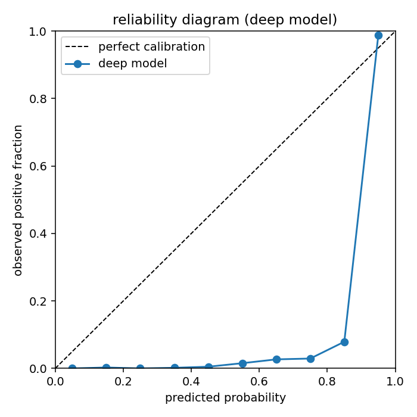
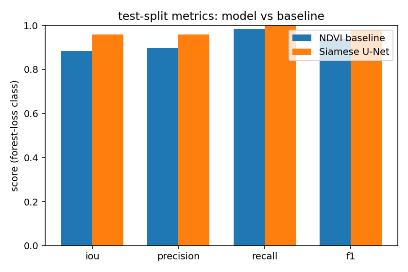
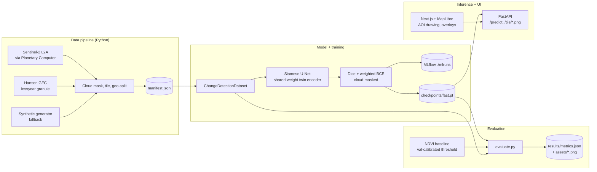

# TerraTrace

[](https://github.com/joshuacowellcay/terratrace/actions/workflows/ci.yml)
[](LICENSE)
[](https://www.python.org/)

Forest-loss change detection from satellite imagery. Draw a region on the map, pick a before
and after date, and the service returns a per-pixel forest-loss heatmap and an estimated
hectares-lost figure. A Siamese U-Net trained with PyTorch sits behind a FastAPI service; a
Next.js + MapLibre frontend handles the AOI and overlays.

> **Data note.** The shipped checkpoint was trained on a procedurally generated synthetic
> dataset because the build ran without a Microsoft Planetary Computer key. The committed
> sample tiles in `data/sample/` are real Sentinel-2 L2A scenes over Rondonia, so the demo
> visualises real imagery even though the model's reported numbers come from the synthetic
> test split. Switching the full training run to real data is one config flag; see
> [MODEL_CARD.md](MODEL_CARD.md).

---

## Demo

<!-- TODO record the GIF using the capture script at assets/demo.gif.TODO -->


The two figures below ship with the repo and are regenerated by `python scripts/evaluate.py`.

| Reliability diagram | Test-split metrics |
| --- | --- |
|  |  |

## Headline metrics

Measured on the geographically separated test split (27 tiles the model never saw during
training). Pulled from `results/metrics.json`; re-run `python scripts/evaluate.py` to refresh.

| Forest-loss class (test split) | **Siamese U-Net** | NDVI baseline (t = 0.425) |
| --- | ---: | ---: |
| IoU             | **0.965** | 0.883 |
| F1              | **0.982** | 0.938 |
| Precision       | 0.965 | 0.897 |
| Recall          | 1.000 | 0.983 |

The deep model beats the calibrated NDVI baseline by 8.2 IoU points overall. On
cloud-affected tiles the gap widens to about 20 IoU points (0.950 vs 0.753): the deep model
has learned context that a single-pixel threshold cannot see. Full breakdown lives in
`results/metrics.json`.

## Design notes

Two failure modes dominate remote-sensing ML projects, so the repo defends against both up
front.

* **Train/test leakage.** Random tile shuffling is the default trap: adjacent tiles share
  cloud cover, BRDF, and physical objects spilling across borders, so a "test" set built that
  way is largely memorisation. `src/terratrace/data/splits.py` divides the tile grid into a
  4x4 macro-block grid and assigns whole blocks to train/val/test. `tests/test_splits.py`
  asserts zero overlap.
* **Misleading headline metric.** Forest-loss pixels are a small minority per tile, so plain
  pixel accuracy reads as ~95% for a "predict zero everywhere" model. The README headlines
  IoU on the loss class only and reports precision/recall separately so the trade-off is
  visible. The deep model is benchmarked against a calibrated NDVI-difference baseline so
  the reported win is against a real comparator, not an absent one.

## Architecture



## Tech stack

Python 3.10+, PyTorch, segmentation-models-pytorch, rasterio, pystac-client,
planetary-computer, scikit-learn, matplotlib, MLflow, FastAPI, uvicorn, pydantic v2, pytest.
Frontend: Next.js 14, TypeScript, Tailwind, MapLibre GL JS. Tooling: ruff, black, ESLint,
Prettier, Docker Compose.

## Quickstart

The data sample and a trained checkpoint are committed, so a fresh clone serves predictions
without any data build or training.

```bash
git clone https://github.com/joshuacowellcay/terratrace.git
cd terratrace

# 1. Environment
python3.12 -m venv .venv
source .venv/bin/activate
pip install -r requirements-dev.txt
pip install -e .

# 2. Start the inference service (uses the committed checkpoint + data/sample/).
export TERRATRACE_FORCE_SYNTHETIC=1   # demo mode; omit when you have STAC access
python scripts/serve.py --port 8000

# 3. In a second terminal, start the frontend.
cd frontend
npm install
NEXT_PUBLIC_API_URL=http://localhost:8000 npm run dev
# open http://localhost:3000 and click two corners on the map
```

One-line API call without the frontend:

```bash
curl -sX POST http://localhost:8000/predict \
  -H 'content-type: application/json' \
  -d '{"bbox":{"west":-63.1,"south":-10.4,"east":-63.0,"north":-10.3},
       "before_date":"2019-07-15","after_date":"2023-07-15"}' \
  | python -m json.tool
```

## Full rebuild

```bash
python scripts/build_dataset.py                       # data/processed/ + data/sample/
python scripts/train.py --config configs/fast.yaml    # CPU-feasible, < 30 min
python scripts/evaluate.py                            # results/metrics.json + assets/*.png
```

`configs/fast.yaml` is what produced the committed checkpoint. `configs/full.yaml` is the
wider/deeper recipe intended for a GPU.

## Real data

Set `fetch_mode: real` in `configs/pipeline.yaml`, ensure outbound HTTPS, then re-run
`python scripts/build_dataset.py`. The manifest at `data/processed/manifest.json` records
which source was used. See [MODEL_CARD.md](MODEL_CARD.md) for the full procedure and caveats.

## Project layout

```
src/terratrace/
  data/                 STAC fetch, synthetic generator, cloud mask, tiling, geo-split
  models/               Siamese U-Net, NDVI baseline
  training/             losses, metrics, train loop, evaluate
  inference/            FastAPI app, tile cache, per-tile rendering
configs/                pipeline.yaml, fast.yaml, full.yaml
scripts/                build_dataset, train, evaluate, serve
tests/                  full suite, runs offline with no GPU and no network
frontend/               Next.js + MapLibre app
data/sample/            6 committed Sentinel-2 tiles (the inference demo runs from these)
checkpoints/fast.pt     21 MB committed model checkpoint
results/metrics.json    source of truth for headline numbers
assets/                 figures rendered by evaluate.py, demo GIF
```

## Tests + CI

```bash
TERRATRACE_FORCE_SYNTHETIC=1 pytest -q          # 57 tests, no network, no GPU
cd frontend && npm test                          # RTL component tests
```

`.github/workflows/ci.yml` runs ruff + black + pytest on the backend and ESLint + Jest +
`next build` on the frontend on every push.

## Known limitations and next steps

* **Synthetic-data ceiling.** The committed checkpoint's headline IoU reflects the
  generator's difficulty, not real Sentinel-2 data. Real numbers will be lower; the
  deep-vs-baseline gap is the more transferable claim.
* **Single AOI.** Training has only seen Rondonia-like distributions. Cross-biome generalisation
  (Borneo peat fires, temperate clear-cuts) needs retraining.
* **Hectares estimate is approximate.** It scales pixel counts by a fixed 10 m^2
  assumption. A production version would derive area per pixel from the raster's CRS and
  transform.
* **No temporal context.** Each prediction looks at two timestamps. A 3D U-Net or LSTM over
  a longer image stack would suppress seasonal-greening false positives.
* **Cloud handling is binary.** Pixels are either valid or masked; a richer model would
  ingest the SCL classes directly so it can reason about haze and shadow separately.

## License

MIT, see [LICENSE](LICENSE).
