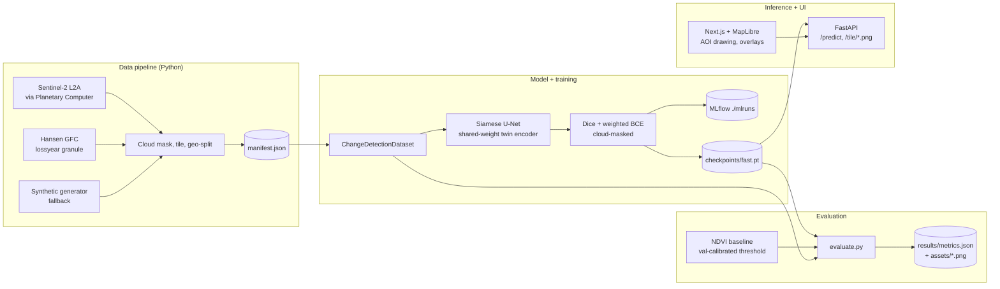

# TerraTrace

[](https://github.com/joshuacowellcay/terratrace/actions/workflows/ci.yml)
[](LICENSE)
[](https://www.python.org/)

Detects forest loss in satellite imagery. You draw a region on the map, pick a before and an
after date, and get back a per-pixel heatmap of where forest was lost plus an estimate of the
area in hectares. The model is a Siamese U-Net trained in PyTorch and served through FastAPI,
with a Next.js and MapLibre frontend for drawing the region and showing the overlays.

> **A note on the data.** I didn't have Microsoft Planetary Computer access when I trained
> the committed checkpoint, so it was trained and tested on synthetic tiles that the repo
> generates procedurally. The sample tiles in `data/sample/` are real Sentinel-2 L2A scenes
> over Rondonia, so the demo shows real imagery, but the numbers below come from the
> synthetic test split. Switching training over to real data is one config flag; see
> [MODEL_CARD.md](MODEL_CARD.md).

---

## Results

Measured on the geographically separated test split (27 tiles the model never saw during
training). The numbers come from `results/metrics.json`; run `python scripts/evaluate.py` to
regenerate them.

| Forest loss class (test split) | **Siamese U-Net** | NDVI baseline (t = 0.425) |
| --- | ---: | ---: |
| IoU             | **0.965** | 0.883 |
| F1              | **0.982** | 0.938 |
| Precision       | 0.965 | 0.897 |
| Recall          | 1.000 | 0.983 |

The deep model beats the calibrated NDVI baseline by 8.2 IoU points overall. On cloudy tiles
the gap grows to about 20 points (0.950 vs 0.753), because the model can use the surrounding
context and a threshold on a single pixel can't. The full breakdown is in
`results/metrics.json`.

| Reliability diagram | Test split metrics |
| --- | --- |
|  |  |

## Design notes

Two mistakes come up a lot in remote sensing ML, and I wanted to avoid both.

* **Train/test leakage.** If you shuffle tiles randomly, neighbouring tiles end up on both
  sides of the split. They share cloud cover, lighting and the actual objects crossing their
  borders, so the test set mostly measures memorisation. `src/terratrace/data/splits.py` cuts
  the tile grid into 4x4 macro blocks and assigns whole blocks to train, val or test, and
  `tests/test_splits.py` checks there's no overlap.
* **A misleading headline metric.** Forest loss is a small fraction of each tile, so a model
  that predicts "no loss" everywhere still gets around 95% pixel accuracy. I report IoU on
  the loss class instead, with precision and recall alongside it, and compare against an
  NDVI difference baseline with a calibrated threshold so the deep model has something real
  to beat.

## Architecture



## Tech stack

Python 3.10+, PyTorch, segmentation-models-pytorch, rasterio, pystac-client,
planetary-computer, scikit-learn, matplotlib, MLflow, FastAPI, uvicorn, pydantic v2, pytest.
Frontend: Next.js 14, TypeScript, Tailwind, MapLibre GL JS. Tooling: ruff, black, ESLint,
Prettier, Docker Compose.

## Quickstart

The data sample and a trained checkpoint are committed, so a fresh clone can serve
predictions without building the dataset or training anything.

```bash
git clone https://github.com/joshuacowellcay/terratrace.git
cd terratrace

# 1. Environment
python3.12 -m venv .venv
source .venv/bin/activate
pip install -r requirements-dev.txt
pip install -e .

# 2. Start the inference service (uses the committed checkpoint + data/sample/).
export TERRATRACE_FORCE_SYNTHETIC=1   # demo mode; omit when you have STAC access
python scripts/serve.py --port 8000

# 3. In a second terminal, start the frontend.
cd frontend
npm install
NEXT_PUBLIC_API_URL=http://localhost:8000 npm run dev
# open http://localhost:3000 and click two corners on the map
```

To call the API directly without the frontend:

```bash
curl -sX POST http://localhost:8000/predict \
  -H 'content-type: application/json' \
  -d '{"bbox":{"west":-63.1,"south":-10.4,"east":-63.0,"north":-10.3},
       "before_date":"2019-07-15","after_date":"2023-07-15"}' \
  | python -m json.tool
```

## Full rebuild

```bash
python scripts/build_dataset.py                       # data/processed/ + data/sample/
python scripts/train.py --config configs/fast.yaml    # runs on CPU in under 30 min
python scripts/evaluate.py                            # results/metrics.json + assets/*.png
```

`configs/fast.yaml` produced the committed checkpoint. `configs/full.yaml` is a wider and
deeper version meant for a GPU.

## Real data

Set `fetch_mode: real` in `configs/pipeline.yaml`, make sure you have internet access, then
run `python scripts/build_dataset.py` again. The manifest at `data/processed/manifest.json`
records which source was used. [MODEL_CARD.md](MODEL_CARD.md) has the full procedure and
caveats.

## Project layout

```
src/terratrace/
  data/                 STAC fetch, synthetic generator, cloud mask, tiling, geo-split
  models/               Siamese U-Net, NDVI baseline
  training/             losses, metrics, train loop, evaluate
  inference/            FastAPI app, tile cache, per-tile rendering
configs/                pipeline.yaml, fast.yaml, full.yaml
scripts/                build_dataset, train, evaluate, serve
tests/                  full suite, runs offline with no GPU and no network
frontend/               Next.js + MapLibre app
data/sample/            6 committed Sentinel-2 tiles (the inference demo runs from these)
checkpoints/fast.pt     21 MB committed model checkpoint
results/metrics.json    where the headline numbers come from
assets/                 figures rendered by evaluate.py
```

## Tests and CI

```bash
TERRATRACE_FORCE_SYNTHETIC=1 pytest -q          # 57 tests, no network, no GPU
cd frontend && npm test                          # RTL component tests
```

`.github/workflows/ci.yml` runs ruff, black and pytest on the backend, and ESLint, Jest and
`next build` on the frontend, on every push.

## Limitations and next steps

* **Synthetic data.** The committed checkpoint's IoU says more about how hard the synthetic
  generator is than about real Sentinel-2 data. Real numbers will be lower; the gap over the
  baseline is the part I'd expect to carry over.
* **One region.** Training has only seen Rondonia-like scenes. Other biomes (peat fires in
  Borneo, clear cuts in temperate forest) would need retraining.
* **Rough area estimate.** Hectares are pixel counts times a fixed 100 m² per pixel (10 m
  Sentinel-2 pixels). A proper version would work out the area of each pixel from the
  raster's CRS and transform.
* **Only two dates.** Each prediction compares two images. A 3D U-Net or an LSTM over a longer
  stack of images would cut down on false positives from seasonal greening.
* **Clouds are on or off.** Pixels are either valid or masked. Feeding the SCL classes in
  directly would let the model treat haze and shadow differently.

## License

MIT, see [LICENSE](LICENSE).
