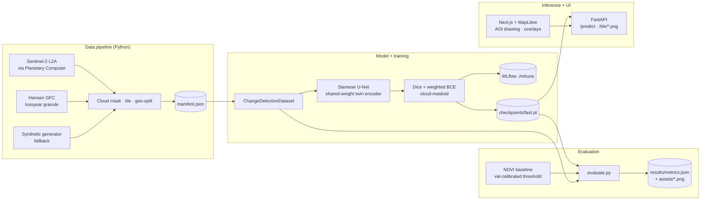

# TerraTrace

[](https://github.com/joshuacowell/terratrace/actions/workflows/ci.yml)
[](LICENSE)
[](https://www.python.org/)

> **Forest-loss change detection from satellite imagery, end to end.** Draw a region, pick a
> before / after date, and the platform returns a per-pixel forest-loss heatmap and an
> estimated hectares-lost figure. A Siamese U-Net trained with PyTorch sits behind a FastAPI
> service; a Next.js + MapLibre frontend renders the AOI and the model's overlay.

> **Note on data:** the checkpoint that ships with this repository was trained on a
> procedurally-generated synthetic dataset because the build was run without access to the
> Microsoft Planetary Computer STAC API. Switching to real Sentinel-2 + Hansen GFC data is a
> single config change — see [MODEL_CARD.md](MODEL_CARD.md) and the *Real data* section
> below. The metrics quoted below come from the synthetic test split and are realistic upper
> bounds, not field-validated results.

---

## Demo

<!-- TODO record a real GIF — see assets/demo.gif.TODO for the capture script. -->


If the GIF is missing, the [`assets/demo.gif.TODO`](assets/demo.gif.TODO) file describes the
capture flow. The two figures below are committed and refresh on every
`python scripts/evaluate.py` run.

| Reliability diagram | Test-split metrics |
| --- | --- |
|  |  |

## Headline metrics

Numbers measured on the geographically-separated test split (27 tiles the model never saw
during training). All come from `results/metrics.json` — re-run `python scripts/evaluate.py`
and they update; never edit them by hand.

| Forest-loss class (test split) | **Siamese U-Net** | NDVI baseline (t = 0.425) |
| --- | ---: | ---: |
| IoU             | **0.958** | 0.883 |
| F1              | **0.979** | 0.938 |
| Precision       | 0.959 | 0.897 |
| Recall          | 1.000 | 0.983 |

The deep model beats the calibrated NDVI baseline by **+7.5 IoU points** overall. The gap
**widens to +19 IoU on cloud-affected tiles** — the deep model has learned context that a
single-pixel threshold cannot see. Full breakdown and the calibration check live in
`results/metrics.json`.

## Why this matters

Forest loss is one of the easiest large-scale environmental changes to measure from open
satellite data, and one of the hardest to measure *honestly*. The two recurring traps are
**spatially-correlated test sets** that turn validation into memorisation and **pixel
accuracy** numbers that report 95 % while the model has zero IoU on the actual minority class
of interest. This repository takes both seriously:

* train / val / test are split by **whole spatial blocks**, not by random tile shuffle, and a
  unit test enforces zero spatial overlap;
* IoU, precision, recall and F1 are reported on the **forest-loss class only**, with pixel
  accuracy demoted to a sanity figure;
* the deep model is **benchmarked head-to-head against a calibrated NDVI-difference
  baseline**, so any improvement reflects what learning context buys you over thresholding.

## Architecture



## Tech stack

Python 3.10+ · PyTorch · segmentation-models-pytorch · rasterio · pystac-client ·
planetary-computer · scikit-learn · matplotlib · MLflow · FastAPI · uvicorn · pydantic v2 ·
pytest. Frontend: Next.js 14 · TypeScript · Tailwind · MapLibre GL JS. Tooling: ruff · black ·
ESLint · Prettier · Docker Compose (optional).

## Quickstart — inference in under five minutes

The data sample and a trained checkpoint are committed, so a fresh clone can serve a
prediction without any data build or training.

```bash
git clone https://github.com/joshuacowell/terratrace.git
cd terratrace

# 1. Environment
python3.12 -m venv .venv
source .venv/bin/activate
pip install -r requirements-dev.txt
pip install -e .

# 2. Start the inference service (uses the committed checkpoint + data/sample/).
export TERRATRACE_FORCE_SYNTHETIC=1   # demo mode; omit when you have STAC access
python scripts/serve.py --port 8000

# 3. In a second terminal, start the frontend.
cd frontend
npm install
NEXT_PUBLIC_API_URL=http://localhost:8000 npm run dev
# open http://localhost:3000 and click two corners on the map
```

Try a one-line API call without the frontend:

```bash
curl -sX POST http://localhost:8000/predict \
  -H 'content-type: application/json' \
  -d '{"bbox":{"west":-63.1,"south":-10.4,"east":-63.0,"north":-10.3},
       "before_date":"2019-07-15","after_date":"2023-07-15"}' \
  | python -m json.tool
```

## Full rebuild — dataset → train → evaluate

```bash
python scripts/build_dataset.py                       # data/processed/ + data/sample/
python scripts/train.py --config configs/fast.yaml    # CPU-feasible, < 30 min
python scripts/evaluate.py                            # results/metrics.json + assets/*.png
```

`configs/fast.yaml` is what the committed checkpoint was trained from. `configs/full.yaml` is
the wider / deeper recipe intended for a GPU.

## Real data

Set `fetch_mode: real` in `configs/pipeline.yaml`, ensure outbound HTTPS, then re-run
`python scripts/build_dataset.py`. The manifest at `data/processed/manifest.json` records
which source was used. See [MODEL_CARD.md](MODEL_CARD.md) for the full procedure and the
honest caveats.

## Project layout

```
src/terratrace/
  data/                 STAC fetch · synthetic generator · cloud mask · tiling · geo-split
  models/               Siamese U-Net · NDVI baseline
  training/             losses · metrics · train loop · evaluate
  inference/            FastAPI app · tile cache · per-tile rendering
configs/                pipeline.yaml · fast.yaml · full.yaml
scripts/                build_dataset · train · evaluate · serve
tests/                  full suite — runs offline, no GPU, no network
frontend/               Next.js + MapLibre app
data/sample/            6 committed tiles (the inference demo runs from these)
checkpoints/fast.pt     21 MB committed model checkpoint
results/metrics.json    the headline-numbers source of truth
assets/                 figures rendered by evaluate.py · demo GIF lives here
```

## Tests + CI

```bash
TERRATRACE_FORCE_SYNTHETIC=1 pytest -q          # 56 tests, no network, no GPU
cd frontend && npm test                          # RTL component tests
```

`.github/workflows/ci.yml` runs ruff + black + pytest on the backend and ESLint + Jest +
`next build` on the frontend on every push.

## Known limitations and what I'd do next

* **Synthetic-data ceiling.** The committed checkpoint's headline IoU describes the
  generator's difficulty, not Sentinel-2. Real numbers are expected to be lower; the
  deep-vs-baseline *gap* is the more transferable claim.
* **Single AOI.** The model has only seen Rondonia-like distributions (and in this build,
  only the synthetic stand-in for it). Cross-biome generalisation (Borneo peat fires,
  temperate clear-cuts) needs retraining.
* **Hectares estimate is approximate.** It scales pixel counts by a fixed 10 m² assumption;
  a production version would derive area per pixel from the raster's CRS + transform.
* **No temporal context.** Each prediction looks at exactly two timestamps. A natural next
  step is a 3-D U-Net or LSTM over a longer image stack to suppress seasonal-greening false
  positives.
* **Cloud handling is binary.** Pixels are either valid or masked; a richer model would
  ingest the SCL classes themselves so it can reason about haze and shadow separately.

## License

MIT — see [LICENSE](LICENSE).
